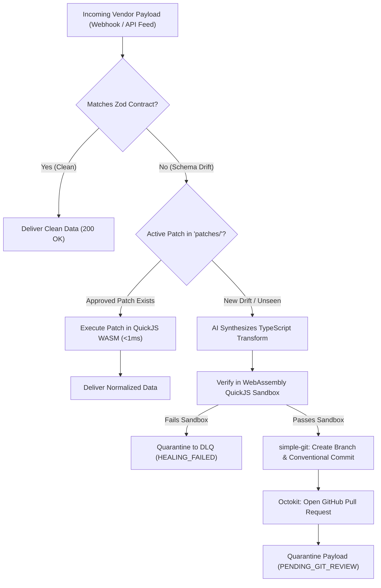

# Rez (`rezjs`)

[](https://github.com/your-org/rezjs/actions/workflows/ci.yml)
[](https://opensource.org/licenses/Apache-2.0)
[](https://www.npmjs.com/package/rezjs)
[](https://nodejs.org/)

> **The automated immune system for third-party webhooks and API feeds.**  
> When external partner schemas drift or break, Rez intercepts the failure, uses multi-provider AI to synthesize a TypeScript repair patch, proves it inside an isolated WebAssembly QuickJS sandbox (<1ms), and opens a Git Pull Request for human review.

**Git is the single source of truth.** No bespoke dashboards, no separate database, no un-sandboxed `eval()` in production. Patches are saved as versioned TypeScript files in `patches/` and reviewed via standard GitHub Pull Requests.

---

## 🏛️ How It Works



1. **Fast-Path**: If a pre-approved patch exists in `patches/`, it runs in **< 1ms** inside a WebAssembly QuickJS isolate.
2. **Contract Enforcement**: Incoming JSON is validated against your user-defined Zod schema contracts.
3. **AI Drift Interception**: When a vendor renames a field, changes date formats, or alters types, the multi-provider AI engine generates a `transform(raw)` mapping.
4. **WASM Sandboxing**: The generated patch is executed in an in-process WebAssembly isolate (QuickJS). It has **zero** filesystem access, **zero** network access, strict 8MB memory quotas, and CPU deadline timers.
5. **GitOps Review**: The patch is saved to `patches/` and committed to an isolated review branch (`rez-patch/...`) via `simple-git`. A GitHub Pull Request is automatically opened.
6. **Payload Quarantine**: The drifted payload is safely quarantined (`status: "PENDING_GIT_REVIEW"`) with PR metadata attached for your Dead Letter Queue (DLQ). Once an engineer clicks **Merge** on GitHub, the patch becomes active for all future payloads.

---

## 🚀 Key Features

* **🔌 Embeddable TypeScript Library**: Zero standalone servers, zero microservices. Drops directly into Express, Fastify, Next.js Route Handlers, Hono, AWS Lambda, or Kafka/SQS worker consumers.
* **🔒 WebAssembly QuickJS Sandboxing**: Executes AI-generated code securely in-process with mathematical runtime isolation. No Docker daemon required.
* **🐙 Mandatory GitOps Review**: Every fix is an audited, signed Conventional Commit (`fix(pipeline): adapt vendor_feed to schema drift`). Git is the patch ledger.
* **🧠 Multi-Provider AI Registry**: Connect to Google, OpenAI, Anthropic, OpenRouter, DeepSeek, Groq, or local Ollama instances through a single unified API.
* **⚙️ Type-Safe `defineConfig`**: Modern configuration discovery (`rez.config.ts`) with full TypeScript autocomplete.

---

## 📦 Installation

```bash
npm install rezjs zod
```

Requirements: Node.js `>= 20.0.0` and a local Git repository (`git init`).

---

## ⚡ Quick Start

### 1. Create `rez.config.ts`

Add a configuration file in your project root:

```typescript
import { defineConfig } from "rezjs";
import { z } from "zod";

export default defineConfig({
  // 1. Model & Provider Configuration
  model: {
    provider: "google", // "google" | "openai" | "anthropic" | "openrouter" | "deepseek" | "groq" | "ollama"
  },

  // 2. Mandatory Git Ledger Configuration
  git: {
    baseBranch: "main",
    patchDir: "patches",
    autoPush: false,               // Set true (or set GITHUB_TOKEN) to push branches automatically
    createPullRequest: true,        // Opens PR via Octokit when GITHUB_TOKEN is present
  },

  // 3. User-Defined Schema Contracts
  contracts: {
    LogisticsShipment: z.object({
      container_id: z.string(),
      carrier_name: z.string(),
      status: z.enum(["IN_TRANSIT", "DELIVERED", "DELAYED", "EXCEPTION"]),
      origin_port: z.string(),
      destination_port: z.string(),
      weight_kg: z.number().positive(),
      eta_date: z.string(),
    }),

    FinancialTransaction: z.object({
      transaction_id: z.string(),
      amount: z.number().positive(),
      currency: z.string(),
    }),
  },
});
```

### 2. Ingest Payloads in Webhooks or API Handlers

```typescript
import { rez } from "rezjs";

// Inside any webhook route (Express, Fastify, Next.js, Lambda, etc.)
app.post("/webhooks/carrier-feed", async (req, res) => {
  const result = await rez.ingest({
    source: "vendor_maersk",
    schema: "LogisticsShipment", // Resolves contract from rez.config.ts
    payload: req.body,
  });

  // If schema drift was intercepted:
  if (result.isQuarantined()) {
    console.warn(`[DRIFT] Quarantined! Created Git branch: ${result.reviewBranch}`);
    if (result.prUrl) console.warn(`[PR] GitHub Pull Request: ${result.prUrl}`);

    // Route broken payload to SQS / Kafka Dead Letter Queue (DLQ) with PR link
    await dlq.push(req.body, {
      reviewBranch: result.reviewBranch,
      prUrl: result.prUrl,
      patchFile: result.patchFile,
    });

    return res.status(202).json({
      status: "quarantined",
      reviewBranch: result.reviewBranch,
      prUrl: result.prUrl,
    });
  }

  // Guaranteed valid, normalized data matching your contract:
  await db.shipments.insert(result.data);
  return res.status(200).json({ status: "success", data: result.data });
});
```

---

## 💡 Programmatic Usage & Custom Instances

You can also instantiate `Rez` programmatically with custom Zod contracts:

```typescript
import { Rez } from "rezjs";
import { z } from "zod";

const OrderSchema = z.object({
  order_id: z.string(),
  total_usd: z.number().positive(),
  status: z.enum(["PENDING", "COMPLETED"]),
});

const instance = new Rez({
  contract: OrderSchema,
  model: { provider: "deepseek" }, // Override provider per instance
});

const result = await instance.ingest({
  source: "shopify_webhook",
  payload: rawPayload,
});

if (result.isSuccess()) {
  console.log("Processed order:", result.data.order_id);
}
```

---

## 🔒 Security: WebAssembly Sandbox

Most "self-healing" AI libraries run unvetted code using `eval()` or child processes. In production, this introduces catastrophic Remote Code Execution (RCE) vulnerabilities.

Rez compiles the **QuickJS** JavaScript engine into **WebAssembly** (`quickjs-emscripten`):

| Property | WebAssembly QuickJS Isolate | Node.js `eval()` / `vm` | Docker Containers |
| :--- | :--- | :--- | :--- |
| **Filesystem Access** | ❌ Blocked (0 access) | ⚠️ Unsafe (escapable) | ⚠️ Shared host mounts |
| **Network Access** | ❌ Blocked (0 access) | ⚠️ Full access | ⚠️ Needs bridge network |
| **Process Globals (`process.env`)** | ❌ None | ⚠️ Full access | ⚠️ Leaks container env |
| **Execution Overhead** | **~0.2 ms** | < 0.1 ms | > 1,500 ms (cold start) |
| **Production-Safe** | ✅ Yes | ❌ Security hazard | ⚠️ Heavy infrastructure |

---

## 🌐 Supported Providers

Rez connects to first-party providers and OpenAI-compatible gateways through a single unified registry:

* **Google** (`google`)
* **OpenAI** (`openai`)
* **Anthropic** (`anthropic`)
* **OpenRouter** (`openrouter`)
* **DeepSeek** (`deepseek`)
* **Groq** (`groq`)
* **Ollama** (`ollama`) / Custom OpenAI-compatible endpoints

Configure credentials via standard environment variables:
```bash
GEMINI_API_KEY="your-key"
# or OPENAI_API_KEY, ANTHROPIC_API_KEY, OPENROUTER_API_KEY, DEEPSEEK_API_KEY, GROQ_API_KEY, OLLAMA_BASE_URL
GITHUB_TOKEN="ghp_xxx"               # Optional: For automated remote push & PR creation
GITHUB_REPOSITORY="owner/repo"       # Optional: GitHub repo slug
```

---

## 🧪 Testing

Run unit tests via Vitest:
```bash
npm test
```

Run the end-to-end integration suite:
```bash
npm run e2e
```

Compile TypeScript definitions:
```bash
npm run build
```

---

## 📄 License

[Apache 2.0](LICENSE) © Rez Contributors.
